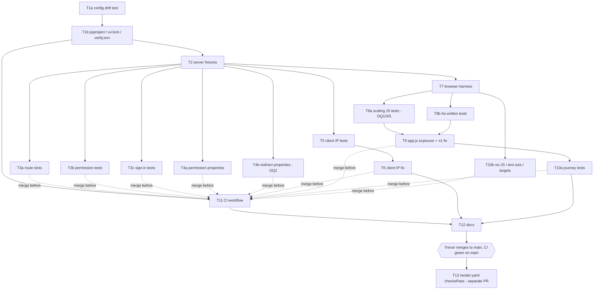

# Verification baseline — plan

Spec: `requirements.md`, `design.md`, `tasks.md` in this folder (approved 2026-10-22 "with defaults":
Q1 yes, Q2 `TRUSTED_PROXY_HOPS=1`, Q3 `autoDeployTrigger: checksPass`).
Integration branch: `ship/verification-baseline` (from `main` at 4b8ea6f). T13 is a separate PR off
`main`, after the rest is merged.

`agent-verify paths`: one flat Flask app at the repo root. There are no packages and no
`package.json`, so every task affects "the one project". Until T1b lands, `fast` is the stopgap
`EXTRA_FAST_CMD` (pyflakes-level ruff plus `unittest discover`). Tools: uv 0.12.23, ruff, semgrep,
gitleaks; docker is broken (not needed); **actionlint is not installed**. Python 3.12.14 (mise) and
3.12.3 (system) are present, so uv needs no Python download. Chromium builds 1247 and 1248 are cached;
Node playwright-core 1.64.1 maps to 1248 (1.64.0-alpha maps to 1247).

## Decisions (Trevor, 2026-10-22)

- **OQ1 → (a)** T9 also makes JS `formatAmount` match `units.format_amount` (Python is the source of
  truth; only edge values change in scaled views). R20 stays as written; T9 owns R20.
- **OQ2 → (a)** T6 also rejects a `next_url` containing a backslash or not starting with exactly one
  `/`. T4b is now **red by design** (the `/\evil` case) and merges together with T6, like T5.
- **OQ3 → confirmed**: R22's "a pinch of" applies only at factor ≠ 1.
- **OQ4 → strict xfail + report**: a failing characterization test lands as
  `@pytest.mark.xfail(strict=True, reason="finding: <one line>")`, only on that test, and the
  implementer reports it to the lead; every xfail is listed first in the hand-off for a bugfix spec.
  Never use this for red-by-design tests (T1a, T4b, T5, T8a, T8b), which merge with their fix.
- **OQ5, OQ6**: proposals below accepted by default (lead's call, flagged in hand-off).

## Open questions (as raised by the planner; resolved above)

Items 1–4 block the tasks named. Everything else can start once T1a is assigned.

1. **R20 does not hold for the current `static/app.js`, and fixing it contradicts "What must not
   change".** I checked this directly (Python `units.format_amount` vs the JS `formatAmount` taken
   from `app.js` and run in node):

   | value | `units.format_amount` | JS `formatAmount` | cause |
   |---|---|---|---|
   | 0.03125 | `0.03` | `1/16` | Python `round()` rounds half to even (0.5 → 0); JS `Math.round` rounds half up (0.5 → 1) |
   | 2.03125 | `2.03` | `2 1/16` | same |
   | 0.322916666666 | `1/3` | `5/16` | tie margin: Python needs a `1e-9` improvement, JS `1e-12` |

   Any odd multiple of 1/32 hits the first case, and hypothesis is likely to find it. T9 may only
   expose the functions and fix ×1 ("exposure and ×1 text only"). Making JS match Python changes
   scaled text that users can see, which "Must not change … any user-visible text except the ×1
   amounts" forbids. **Decide:** (a) fold "make `formatAmount` match `units.format_amount`" into T9
   (the scaled text changes only for these edge values), (b) narrow R20 to exclude these values and
   open a bugfix spec, or (c) land R20 as `xfail(strict=True)` pending a bugfix spec (needs your
   explicit OK under the no-skip rule). **Blocks T8a's R20 test and T9's scope.** `unitLabel` matches
   `unit_label` as far as I can see.
2. **R14 as designed fails on current code, though no attacker can reach the failing input.**
   `login_with_token` accepts any `next_url` that starts with `/` and not `//`. The design's own input
   `/\evil.example/x` passes that check, and Flask sends `Location: /\evil.example/x` unchanged
   (verified). Browsers treat that as `//evil.example/x`, which is off-site. Only `require_login()`
   sets `next_url`, from `request.full_path` of GET `/add`, `/me` or `/recipe/<slug>/edit`, and
   Werkzeug merges `//` paths, so the value can't be chosen without forging the signed session.
   `safe_referrer()` held up (`http://localhost.evil.example/` gives `/`). **Decide:** (a) fix it in
   this spec (a one-line backslash/`urlsplit` check in `login_with_token`, added to T6's ownership of
   `app.py`), (b) limit R14's `next` inputs to paths `require_login()` can produce, or (c) separate
   bugfix spec plus a strict xfail. **Blocks T4b.**
3. **R22 contradicts R21 (Q1) at ×1.** R22 says "below 1/8 teaspoon THE page SHALL say 'a pinch
   of'", but under R21 the ×1 page shows the server's `1/16 teaspoon` for "1/16 tsp salt". The plan
   assumes R22's pinch clause covers only factor ≠ 1. **Confirm.** (Blocks only that one assertion
   in T8a.)
4. **What happens when a characterization test fails (T3a–c, T4a–b, T10a–b)?** tasks.md says report
   it and don't fix it in the test task. But a red test can't merge without making `fast` or CI red,
   and the no-skip rule forbids `skip`/`xfail` without you. **Decide on a standing rule:** either the
   task is held unmerged until a bugfix lands, or the single failing test lands as
   `pytest.mark.xfail(strict=True, reason="finding: <link>")`. Until you decide, implementers hold
   and report.
5. **R23's tolerance wording is ambiguous.** It says "converted back to the original unit, be within
   0.035 of the displayed unit of qty × factor". Proposed reading for T8a:
   `|to_original(displayed) − qty×factor| ≤ 0.035 × size_of(displayed unit, in original units)`,
   i.e. the snapping error `format_amount` already allows, measured in the displayed unit. For a
   range (`qty_max`) where the max ends up in a different unit, the JS drops the max, so only the min
   is checked. **Confirm.**
6. **`.gitignore` isn't in the spec's change list**, but hypothesis writes `.hypothesis/` at the
   repo root (pytest and ruff caches ignore themselves). The plan gives T1b the job of adding
   `.hypothesis/` and `test-results/` (pytest-playwright's failure artifacts). **Confirm**, or say
   where they should go instead.
7. **R4 vs the import-order autofix (recorded, not blocking).** R4 says the 50 tests stay
   "unchanged", but `ruff check --fix --select I` touches `test_cookbook.py:215` (swaps the
   function-level `import photos` / `from PIL import Image`; both still run after `DATA_DIR` is set)
   and expands `app.py`'s `from flask import (...)` to one name per line. design.md already accepts
   this. Test bodies don't change.
8. **Requirements no agent can verify:** R32 (runs on push/PR) and R34 (Render deploys only checked
   commits) can only be observed on GitHub and Render after you push. R37's hop-count confirmation
   needs the production log. R30's "no real email" is checked locally by stubbing `mailer.send`
   *and* `urllib.request.urlopen` in the live server (T7), not by observing Resend.
9. **Production actions (yours, not agents'):**
   - Merging this branch to `main` deploys production (`autoDeploy: true`). That deploy changes
     which IP the sign-in rate limit counts (T6) and the ×1 amount text (T9).
   - After that deploy, request a sign-in link and read `sign-in requested ip=… forwarded_entries=N`
     in Render → Logs. Set `TRUSTED_PROXY_HOPS` in Render → Environment if the IP is wrong. If the
     hop count is too low, all visitors share one 20-per-hour sign-in bucket until you fix it.
   - T13 (`render.yaml`) goes in a separate PR, only after the `checks` run is green on `main`. Check
     the field name against Render's Blueprint reference, then confirm in Render that Auto-Deploy says
     "After CI checks pass".
10. **Network needs (sandbox allowlist):** T1a/T1b need PyPI (`pypi.org`, `files.pythonhosted.org`)
    for pytest/hypothesis/playwright and `uv.lock`. T11 needs `github.com` (and `api.github.com` or
    `git ls-remote`) to resolve action tags to SHAs and to fetch the gitleaks release checksums.
    actionlint isn't installed (`uvx --from actionlint-py actionlint` needs PyPI). Later worktrees
    should resolve from the shared uv cache (`~/.cache/uv`). If one tries the network, allow the two
    PyPI hosts. No task may download Playwright browsers (no CDN access). If T1b can't find a Python
    `playwright` release whose Chromium revision is 1247 or 1248, it stops and reports.

## Conventions for every task

- Synthetic data only: `@example.com` emails and invented names. Never `MAIL_PROVIDER=resend|smtp`.
  Never a real `DATA_DIR`. Nothing may write to the repo's `data/`.
- `DATA_DIR` (temp) and `MAIL_PROVIDER=console` are set **before** `import app`. Only
  `tests/conftest.py` (T2) and `tests/browser/conftest.py` (T7) do the import-time setup.
- **Nobody but T2 edits `tests/conftest.py`, and nobody but T7 edits `tests/browser/conftest.py`.**
  A parallel task that needs a helper defines it inside its own test file. If a shared fixture is
  truly missing, report it to the lead (who opens a follow-up on T2/T7) instead of editing the file.
- To vary a client IP, tests use `environ_base={"REMOTE_ADDR": ...}`, never `X-Forwarded-For`, so they
  keep passing after T6 changes how `X-Forwarded-For` is read.
- Signed-out POST tests must send a valid CSRF token (GET a page first). Without one, the `guard()`
  hook redirects to the referrer/index before `require_login()` runs, so R6's `/login` redirect never
  happens.
- A failing characterization test is a finding: report test id, request and observed vs expected to
  the lead (see open question 4). Never edit product code or loosen the test inside a test task.
- Red-by-design test tasks (T1a pytest run, T5, T8a, T8b) say so in their hand-off and paste the
  failing ids. **The lead merges each one immediately before its implementer (T1a→T1b, T5→T6,
  T8a/T8b→T9)**, or bases the implementer's worktree on the test branch and merges both together.
  The integration branch is never left red between those merges.
- `full` adds only scanners here (there's no build). The lead runs `agent-verify full` and
  `agent-verify e2e` on the integration branch after each merge wave.

## Tasks

### T1a. Project-config drift test (test-writer)
- **Goal:** a test that fails when `pyproject.toml` and `requirements.txt` declare different runtime
  pins.
- **Requirements:** R1.
- **Owns:** `tests/__init__.py`, `tests/test_project_config.py`.
- **Deps:** none.
- **Notes:** stdlib only (`tomllib`, plain `assert`) so the module still imports under the current
  `unittest discover` stopgap, which recurses into `tests/` once `__init__.py` exists. Strip the
  inline comment on the `pillow-heif` line and normalise names (`Pillow`, `pillow-heif`) per PEP 503.
  Include a case that feeds the comparison helper a deliberately drifted pair and expects a
  mismatch, so the check is proven to bite.
- **Verify:** `agent-verify fast` stays green (the stopgap imports the module and finds no
  TestCase). `uv run --no-project --with pytest python -m pytest -q tests/test_project_config.py`
  **fails** only because `pyproject.toml` is missing (expected).
- **Risk:** low. Test only, ~60 lines.

### T1b. Python project config
- **Goal:** add `pyproject.toml` and `uv.lock`, switch `fast` to the kit's native ruff and pytest,
  and set `E2E_CMD`.
- **Requirements:** R1, R2, R3, R4, R5.
- **Owns:** `pyproject.toml`, `uv.lock`, `.kit/verify.env`, `.gitignore` (open question 6),
  and in `app.py` and `test_cookbook.py` **only** the edits from `uv run ruff check --fix --select I .`.
- **Deps:** T1a.
- **Notes:** follow the design's `pyproject.toml` exactly: no build backend,
  `requires-python = ">=3.12,<3.13"`, the four runtime pins, dev group pytest + hypothesis +
  pytest-playwright + playwright (exact pins), pytest options
  (`pythonpath`, `testpaths = ["test_cookbook.py", "tests"]`, the `e2e` marker, `--strict-markers`),
  ruff `E,F,W,B,I` ignoring `E501,B904`. Pick the `playwright` pin by checking
  `uv run playwright install --dry-run chromium`: it must print a cached path
  (`chromium-1247` or `chromium-1248`). In `.kit/verify.env`, delete `EXTRA_FAST_CMD` and its
  comment, add `E2E_CMD="uv run pytest -m e2e"`, and leave `RISK_PATHS` alone. Don't touch
  `requirements.txt`, `render.yaml`, `Procfile` or `Dockerfile`.
- **Verify:** `agent-verify fast --all` must show no "no pyproject.toml" warning, ruff and pytest
  steps run by the kit, no unittest step, and ≥ 52 tests passed (50 + T1a's). Also:
  `uv lock --check`; `uv run playwright install --dry-run chromium` (cached revision);
  `git diff main -- requirements.txt render.yaml Dockerfile Procfile` is empty; and
  `git diff main -- app.py test_cookbook.py` shows import-block changes only.
- **Risk:** medium. It changes what "done" means for every later task; it adds dependencies (dev
  group only); it touches `app.py` (risk path `routes-auth-permissions`), though only the import
  block. `uv.lock` is generated, so it's not counted toward the ~200 lines.

### T2. Server test fixtures (test infra)
- **Goal:** shared pytest fixtures for route tests: isolated temp DB per test, captured mailbox, real
  sign-in flow, recipe factory, CSRF helper, hypothesis profile.
- **Requirements:** supports R6–R18 and R35–R37.
- **Owns:** `tests/conftest.py`, `tests/test_fixtures_smoke.py`.
- **Deps:** T1b.
- **Notes:** follow the design (session-level env set before `import app`; pop `RESEND_API_KEY`,
  `SMTP_HOST`, `ANTHROPIC_API_KEY`). Make the per-test `DATA_DIR` + `db.init()` fixture **autouse
  for everything under `tests/`**. `test_cookbook.py`'s `PhotoTests.tearDownClass` pops `DATA_DIR`
  globally and pytest runs that file first; without autouse, a later test would fall back to the
  repo's `data/`. Register hypothesis profiles here (`max_examples≈50`, `deadline=None`, suppress
  `function_scoped_fixture` only where a test resets state per example). Provide a `fresh_db()`
  helper that property tests can call once per hypothesis example, because the 20/hour per-IP and
  6/hour per-user sign-in limits and the 12/hour add limit would otherwise build up across examples.
  Don't set `app.testing = True` globally: R16's 500-response test needs the real error handler.
  Smoke tests cover: sign-in round trip, isolation between two tests, mailbox capture, no leaked env
  vars, and `db.data_dir()` never being the repo's `data/`.
- **Verify:** `agent-verify fast`; `uv run pytest -q tests/test_fixtures_smoke.py`.
- **Risk:** medium. Every server test depends on this; a leak here could write to the local dev DB
  or let a real mail provider through.

### T3a. Route tests (test-writer, characterization)
- **Goal:** pin down hidden-recipe visibility, CSRF, security headers, escaping and the photo-name
  guard.
- **Requirements:** R10, R12, R16, R17, R18.
- **Owns:** `tests/test_routes.py`.
- **Deps:** T2.
- **Notes:** R10: hide recipes by direct DB update (no route sets `is_hidden`), and check the index,
  `?q=`, every filter (`cuisine`, `meal`, `tag`, `ingredient`) and the facet lists. R12: every POST
  route, including `/api/parse` (the guard redirects before its own 400). R16: 200, 302, 403, 404
  and 500 responses (force a 500 by monkeypatching, with the real error handler running) and a
  static file. R17: title, description, ingredient and note go through the form. A credit can't
  contain `<` (`check_credit` allows letters only), so put HTML in `credited_to` by direct DB update.
  R18: patterns that miss the regex, with the filesystem monkeypatched to fail if touched.
- **Verify:** `agent-verify fast`; `uv run pytest -q tests/test_routes.py`. Expected to pass on
  current code.
- **Risk:** low. Test only, ~180 lines.

### T3b. Permission tests (test-writer, characterization)
- **Goal:** signed-out redirects, non-owner refusals and blocked users, all leaving data unchanged.
- **Requirements:** R6, R7, R11.
- **Owns:** `tests/test_permissions.py`.
- **Deps:** T2.
- **Notes:** "unchanged" means the recipe row, ingredients, tags, photo rows and photo files are
  compared before and after. R7 edit gives a redirect plus flash; delete and delete-comment give
  403. Include the admin-allowed counterpart of each refusal, so the tests prove the check rather
  than a broken route.
- **Verify:** `agent-verify fast`; `uv run pytest -q tests/test_permissions.py`. Expected to pass.
- **Risk:** low. Test only, ~170 lines.

### T3c. Sign-in tests (test-writer, characterization)
- **Goal:** the token lifecycle, rate limits and bot traps on `/login`.
- **Requirements:** R13, R15 (plus the design's bot-trap cases).
- **Owns:** `tests/test_signin.py`.
- **Deps:** T2.
- **Notes:** R13 covers used, expired (set `expires_at` in the DB) and unknown tokens, and checks
  the raw token never appears in any `login_tokens` column. R15: the 7th request per user, and the
  21st per IP (needs at least 4 users, same `REMOTE_ADDR`). Both refusals send nothing (the mailbox
  stays empty). Bot traps: `started_at=now` gives the "very fast" rejection, and a filled honeypot
  is blocked.
- **Verify:** `agent-verify fast`; `uv run pytest -q tests/test_signin.py`. Expected to pass.
- **Risk:** low. Test only, ~150 lines.

### T4a. Permission property tests (test-writer, characterization)
- **Goal:** a hypothesis state machine for ownership rules, and the property that `credited_to`
  grants no rights.
- **Requirements:** R8, R9.
- **Owns:** `tests/test_permission_properties.py`.
- **Deps:** T2.
- **Notes:** a `RuleBasedStateMachine` as in the design. Call `fresh_db()` in `@initialize`. Give
  each simulated user its own test client and a distinct `REMOTE_ADDR`. Cap users and recipes per
  run under the rate limits (6 sign-ins per user per hour, 12 adds per user per hour). Photo-remove
  goes through edit POST `remove_photo`. Keep the file under ~30 s with the T2 profile.
- **Verify:** `agent-verify fast`; `uv run pytest -q tests/test_permission_properties.py
  --hypothesis-show-statistics` (report the runtime). Expected to pass.
- **Risk:** medium. A slow or flaky property test makes `fast` and CI slow or flaky.

### T4b. Redirect property tests (test-writer, characterization). Blocked by open question 2
- **Goal:** the redirect after sign-in and `safe_referrer()` never leave the site.
- **Requirements:** R14.
- **Owns:** `tests/test_redirect_properties.py`. tasks.md had R14 in `test_permission_properties.py`;
  it's split out so the blocked part doesn't hold up T4a.
- **Deps:** T2, plus a decision on open question 2. If the decision is "fix it", this task also
  goes red-by-design and the fix joins T6.
- **Notes:** judge "on-site" the way a browser would. Resolve `Location` with WHATWG rules (treat
  `\` as `/`, strip tab/newline) against the test host; don't just check that `urlsplit().netloc`
  is empty, because that misses `/\evil`.
- **Verify:** `agent-verify fast`; `uv run pytest -q tests/test_redirect_properties.py`.
- **Risk:** low. Test only, ~90 lines.

### T5. Client IP tests (test-writer, red by design)
- **Goal:** specify the `X-Forwarded-For` hop counting, the spoof-resistance property and the
  sign-in log line.
- **Requirements:** R35, R36, R37.
- **Owns:** `tests/test_client_ip.py`.
- **Deps:** T2.
- **Notes:** use `app.app.test_request_context(headers=..., environ_base={"REMOTE_ADDR": ...})` and
  `monkeypatch.setenv("TRUSTED_PROXY_HOPS", ...)`. Cover: default 1; 0, negative and non-numeric
  values fall back to 1 with one startup log line (call `app.create_app()` again under `caplog`);
  fewer entries than hops gives the socket address. R36 is a property: `P + S` vs `S` with
  `len(S) == hops`. R37: POST `/login` under `caplog` logs `ip=` and `forwarded_entries=` and **no
  email address**.
- **Verify:** `uv run pytest -q tests/test_client_ip.py` **fails** on the multi-entry R35, R36, R37
  and startup-log cases (expected; list the ids). `uv run pytest -q -m "not e2e"
  --ignore=tests/test_client_ip.py` passes. `uv run ruff check tests/test_client_ip.py` passes.
  `agent-verify fast` is red only on this file.
- **Risk:** low. Test only, ~120 lines.

### T6. Client IP fix
- **Goal:** count `TRUSTED_PROXY_HOPS` entries from the right of `X-Forwarded-For`, log the setting
  at startup, and log the IP and entry count on each sign-in request.
- **Requirements:** R35, R36, R37 (and R14 if open question 2 is answered "fix it").
- **Owns:** `app.py`: `client_ip()`, a new `_int_env` helper, one startup log line next to
  `log.info("mail: ...")` in `create_app()`, one `log.info` in `login()` POST. Nothing else.
- **Deps:** T5 (merged together with it), T1b.
- **Notes:** the design gives the code. Compute `client_ip()` once in `login()` and use it for both
  the bucket and the log line. Don't put email addresses in the new line.
- **Verify:** `agent-verify fast` is all green (T5 now passes). `agent-verify diff` shows
  `routes-auth-permissions` under "Needs attention" as expected, with only those functions in the
  diff.
- **Risk:** high. Rate limiting on the sign-in path. It changes production behaviour on deploy, and
  a wrong hop count puts every visitor in one 20/hour bucket (production follow-up in open question
  9).

### T7. Browser test harness (test infra)
- **Goal:** an in-process live server on 127.0.0.1, a per-test DB, captured mail, and a guard that
  fails any test whose page makes an off-origin request.
- **Requirements:** R30, R31.
- **Owns:** `tests/browser/__init__.py`, `tests/browser/conftest.py`, `tests/browser/test_harness.py`.
- **Deps:** T2 (reuses its import-time env setup), T1b (`E2E_CMD`).
- **Notes:** in `pytest_collection_modifyitems`, auto-mark everything under `tests/browser/` with
  `e2e`, so nothing there runs in `fast`. Serve with `make_server("127.0.0.1", 0, ...)`, never
  `0.0.0.0`. Override pytest-base-url's `base_url` with the live URL. Patch `mailer.send` to
  capture, **and** stub `urllib.request.urlopen` to raise, so server-side mail or AI calls fail
  loudly (R30). The off-origin guard uses `page.route("**/*")` plus a teardown assertion. Provide
  `fill_like_a_person`. With JS disabled `page.evaluate` may not run; if so, document that no-JS
  form tests wait 2.1 s instead. Harness tests cover: binding is 127.0.0.1, a deliberate
  off-origin `fetch` is caught and fails, and a sign-in sends no real mail.
- **Verify:** `agent-verify e2e` (harness tests pass in cached Chromium); `agent-verify fast`
  (browser tests deselected and collection still OK). If Chromium can't start inside the sandbox,
  report it. Don't bypass the sandbox.
- **Risk:** medium. Every e2e test depends on it, and R30 is a security property.

### T8a. app.js scaling tests (test-writer, red by design). R20 part blocked by open question 1
- **Goal:** JS formatting matches the Python side, plus the README examples and the scaling
  accuracy property.
- **Requirements:** R19 (exposure, asserted), R20, R22, R23.
- **Owns:** `tests/browser/test_scaling_js.py`.
- **Deps:** T7, plus decisions on open questions 1, 3 and 5.
- **Notes:** batch `page.evaluate` calls per hypothesis example batch (design). Put the grid of
  common fractions and the open-question-1 counterexamples (0.03125, 2.03125, 0.322916666666) in as
  explicit `@example`s. R22's pinch clause only at factor ≠ 1 (open question 3).
- **Verify:** `uv run pytest -m e2e tests/browser/test_scaling_js.py` **fails** with
  `ValentineScaling` undefined (expected), plus R20 counterexamples unless open question 1 resolves
  them. `agent-verify fast` stays green.
- **Risk:** low. Test only, ~150 lines.

### T8b. "As written" tests (test-writer, red by design)
- **Goal:** at ×1, with JS on, JS off, and after ×2 → "As written", every `.amount` (and unitless
  item text) equals the server-rendered text.
- **Requirements:** R21.
- **Owns:** `tests/browser/test_as_written.py`.
- **Deps:** T7.
- **Notes:** recipes include the 5 mismatching lines from the requirements table, plus generated
  lines and a unitless counted item ("1 egg").
- **Verify:** `uv run pytest -m e2e tests/browser/test_as_written.py` **fails** on the table's
  mismatches (expected; list them). `agent-verify fast` stays green.
- **Risk:** low. Test only, ~110 lines.

### T9. app.js exposure and the "As written" fix
- **Goal:** expose `window.ValentineScaling` (frozen) and make ×1 restore the server's text.
- **Requirements:** R19, R21 (and R20 if open question 1 is answered (a)).
- **Owns:** `static/app.js`.
- **Deps:** T8a, T8b (merged together with them).
- **Notes:** as in the design. Store each `.amount`'s text before the first `apply()`. When
  `Math.abs(factor - 1) < 0.001`, restore those texts and the unitless item text, and clear the
  `changed` class. No template, CSS or CSP change. `textContent` only.
- **Verify:** `agent-verify e2e` (T8a, T8b and T7 green); `agent-verify fast`.
- **Risk:** medium. Every visitor's recipe page runs this JS, and it changes amount text users can
  see at ×1 (the change Q1 approved).

### T10a. Journey tests: browse, add, share (test-writer, characterization)
- **Goal:** the visitor, submitter and second-member journeys end to end.
- **Requirements:** R24, R25, R26.
- **Owns:** `tests/browser/test_journeys.py`.
- **Deps:** T7, T9. R25's "back to As written" check relies on R21 behaviour, so this merges after
  T9.
- **Notes:** the photo is a 1600×1200 JPEG made with Pillow in `tmp_path`. Delete forms use
  `data-confirm` → `window.confirm`, and Playwright dismisses dialogs by default, so accept it
  explicitly or the delete is cancelled.
- **Verify:** `agent-verify e2e`. Expected to pass; a product bug is reported, not worked around.
- **Risk:** low. Test only, ~190 lines.

### T10b. No-JS, text size and target-size tests (test-writer, characterization)
- **Goal:** the page works without JS, A+ persists after reload, and scaler and header targets are
  at least 44×44 px.
- **Requirements:** R27, R28, R29.
- **Owns:** `tests/browser/test_page_basics.py` (split from tasks.md's `test_journeys.py` to keep
  tasks around 200 lines and parallel).
- **Deps:** T7.
- **Notes:** R29's selector `header a, header button` also matches the recipe page's
  `<header class="recipe-head">`; that's intended (spec says "header"). If the no-JS add form
  can't backdate `started_at`, wait 2.1 s (see T7).
- **Verify:** `agent-verify e2e`. Expected to pass; a too-small target is a finding.
- **Risk:** low. Test only, ~120 lines.

### T11. CI workflow
- **Goal:** one GitHub Actions job, `checks`, that runs ruff, pytest (not e2e), e2e in Chromium,
  and gitleaks, with no secrets, read-only contents permission and SHA-pinned actions.
- **Requirements:** R32, R33.
- **Owns:** `.github/workflows/ci.yml`.
- **Deps:** T1b to start. **Merge after** T3a, T3b, T3c, T4a, T4b, T6, T9, T10a and T10b, so the
  first run on GitHub is green (dashed edges in the DAG).
- **Notes:** follow the design's steps. Resolve every `uses:` tag to a full SHA (tag in a comment)
  and download the gitleaks release with checksum verification; both need github.com (open question
  10). Full-history `gitleaks git --redact` is clean today (18 commits, no leaks, checked). The
  workflow must not set `MAIL_PROVIDER`.
- **Verify:** lead runs `agent-verify full` on the integration branch. Lint the workflow with
  `uvx --from actionlint-py actionlint .github/workflows/ci.yml` (or report it unavailable). Run the
  workflow's commands locally in order: `uv sync --locked && uv run ruff check . && uv run pytest -q
  -m "not e2e" && uv run pytest -m e2e && gitleaks git --redact .`. `grep -nE 'uses: .*@[0-9a-f]{40}'`
  matches every `uses:` line. Trevor checks the green run on GitHub after he pushes.
- **Risk:** high. CI and supply-chain config that will gate production deploys (T13).

### T12. Docs
- **Goal:** AGENTS.md and README.md describe the new checks, markers, env var and deploy gate.
- **Requirements:** none directly. Supports R31 and R35 (operators need `TRUSTED_PROXY_HOPS`).
- **Owns:** `AGENTS.md`, `README.md`.
- **Deps:** T6, T9, T10a, T10b, T11 (docs describe what landed; test count is final).
- **Notes:** AGENTS.md: replace the testing paragraph (pytest, `tests/`, `e2e` marker, hypothesis),
  remove the "no route/permission tests / no e2e / no CI" statements and the
  `client_ip()`-spoofable trap, fix "README says 48 tests", and add `TRUSTED_PROXY_HOPS` and the
  pending deploy gate (T13). README.md: the "Running it here" commands (`uv sync`, `uv run pytest`),
  the test count from `uv run pytest --collect-only -q`, and `TRUSTED_PROXY_HOPS` in the env table.
  Leave `render.yaml` statements as `autoDeploy: true` until T13.
- **Verify:** `agent-verify fast`. The test count in README equals
  `uv run pytest --collect-only -q | tail -1`.
- **Risk:** low.

### T13. Gate Render deploys on CI (separate PR, after T11 is green on `main`)
- **Goal:** `autoDeploy: true` becomes `autoDeployTrigger: checksPass`; nothing else in
  `render.yaml` changes.
- **Requirements:** R34.
- **Owns:** `render.yaml`, plus one line in `AGENTS.md`'s Deploy section ("a push to `main` deploys
  production" → "deploys once CI passes"). T12 has merged by then, so there's no overlap.
- **Deps:** the whole integration branch merged to `main` by Trevor, and the `checks` run green on
  that `main` commit. Branch from `main`, not from `ship/verification-baseline`.
- **Verify:** `agent-verify full`. `git diff main -- render.yaml` is exactly one line removed and one
  added. Then Trevor's production steps (design.md, open question 9).
- **Risk:** high. Production deploy config. If the field name is wrong, Render may ignore it (still
  auto-deploying) or stop deploying.

## Requirement coverage

| Req | Task(s) | | Req | Task(s) |
|---|---|---|---|---|
| R1 | T1a, T1b | | R20 | T8a → T9 (open question 1) |
| R2–R5 | T1b | | R21 | T8b → T9 |
| R6, R7, R11 | T3b | | R22, R23 | T8a |
| R8, R9 | T4a | | R24–R26 | T10a |
| R10, R12, R16–R18 | T3a | | R27–R29 | T10b |
| R13, R15 | T3c | | R30, R31 | T7 |
| R14 | T4b (open question 2) | | R32, R33 | T11 |
| R19 | T8a → T9 | | R34 | T13 |
| R35–R37 | T5 → T6 | | | |

## Parallel waves (disjoint ownership checked)

| Wave | Tasks in parallel | Files owned |
|---|---|---|
| 0 | T1a | `tests/__init__.py`, `tests/test_project_config.py` |
| 1 | T1b | `pyproject.toml`, `uv.lock`, `.kit/verify.env`, `.gitignore`, imports in `app.py`, `test_cookbook.py` |
| 2 | T2, T11 (draft only) | `tests/conftest.py`, `tests/test_fixtures_smoke.py` / `.github/workflows/ci.yml` |
| 3 | T3a, T3b, T3c, T4a, T4b*, T5, T7 | one test file each / `tests/browser/{__init__,conftest,test_harness}.py` |
| 4 | T6, T8a*, T8b, T10b | `app.py` / one browser test file each |
| 5 | T9 | `static/app.js` |
| 6 | T10a, then merge T11 | `tests/browser/test_journeys.py` / (T11 already drafted) |
| 7 | T12 | `AGENTS.md`, `README.md` |
| later PR | T13 | `render.yaml`, one line of `AGENTS.md` |

\* blocked on an open question. `app.py` is owned by T1b (imports) and T6 (functions) in different
waves; `AGENTS.md` by T12 and T13 in different PRs.

